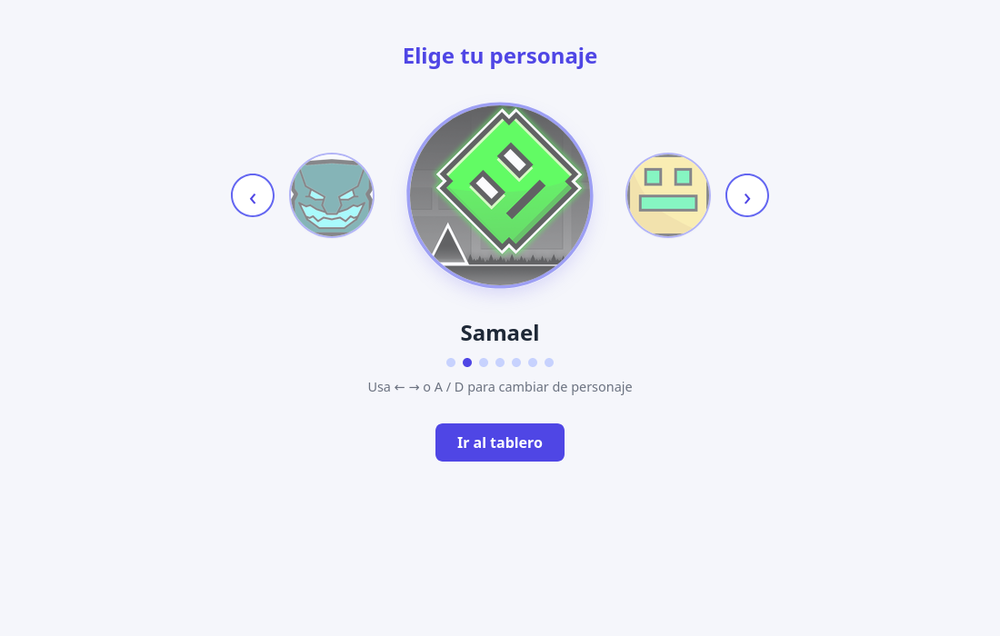
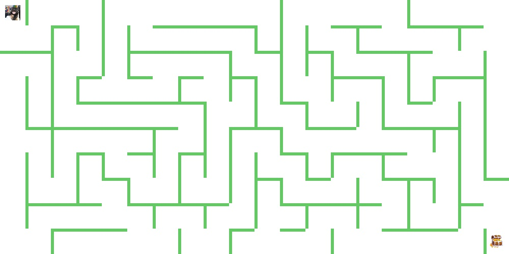

# maze-game-django-opencv

Juego de laberinto hecho con Django y OpenCV. El laberinto se genera al azar cada partida, eliges un personaje y tienes que llegar al tesoro. Lo curioso es que el navegador no dibuja nada: cada vez que apretas una tecla el servidor arma la imagen del juego con OpenCV y te la devuelve, o sea el tiempo del juego está "discretizado", el mundo solo avanza un paso por tecla.




## Cómo levantarlo

Necesitas Docker. Después corres esto en la carpeta del proyecto:

```
docker compose up -d --build
docker compose exec api python manage.py migrate
docker compose exec api python poblar_personajes.py
```

- `migrate` crea las tablas en PostgreSQL.
- `poblar_personajes.py` carga los personajes (incluidos los perros, sus fotos están en `static/`).

Y entras a **localhost:8000/api/seleccion-personaje**

Si da error de conexión con la base de datos, cambia `db` por `localhost` en `juego/settings.py`.

## Cómo se juega

- En la selección cambias de personaje con las flechas o con **A / D**, y le das a **Ir al tablero** (o Enter).
- En el tablero te mueves con **W A S D**.
- Llegas al tesoro (abajo a la derecha) y ganas.
- Con **Exit** vuelves a la selección. Tu posición queda guardada, si no terminaste el laberinto sigue igual cuando vuelvas. Si lo terminaste, al salir se genera uno nuevo.

## Cómo funciona el laberinto

El tablero es una cuadrícula de 20 x 10 celdas de 50 px (200 celdas). Si lo piensas como un grafo, cada celda es un nodo y cada pared entre dos celdas vecinas es una arista.

Para generarlo uso un **DFS aleatorio** (recursive backtracker), está en `backend/generar_imagen/Laberinto.py`:

1. Parte en la celda (0,0) con todas las paredes puestas.
2. Baraja las 4 direcciones y se mueve a un vecino que no haya visitado, rompiendo la pared entre los dos.
3. Repite desde ahí. Si se queda sin vecinos libres se devuelve (backtracking) hasta encontrar otro camino.

Como solo rompe paredes hacia celdas no visitadas, el resultado es un árbol: todas las celdas quedan conectadas y entre dos celdas hay **un solo camino**, así que siempre se puede llegar al tesoro. Con 200 celdas el camino al tesoro es bastante más largo (en una prueba pasó por 73 celdas). Las paredes que quedan se guardan en la tabla `Pared` y se dibujan con una función que arma las líneas pixel por pixel.

Para los choques se trata todo como rectángulos: si el personaje se va a meter en una pared, con min/max se deja justo al lado de ella en vez de cancelar el movimiento. El personaje mide 30 px y avanza 10 px por tecla, así cabe justo por los pasillos de 45 px.

## Archivos importantes

| Archivo | Qué hace |
|---|---|
| `backend/generar_imagen/Laberinto.py` | genera el laberinto, lo dibuja y resuelve los choques |
| `backend/generar_imagen/Jugador.py` | mueve al personaje y no lo deja salirse de la imagen |
| `backend/views.py` | arma cada frame, detecta cuando ganas y reinicia el laberinto |
| `backend/templates/seleccion_personaje.html` | la selección de personajes en carrusel |
| `backend/templates/tablero.html` | el tablero, manda las teclas y muestra la imagen |
| `poblar_personajes.py` | carga los personajes en la base de datos |

## Tecnologías

Python, Django, OpenCV, NumPy, PostgreSQL, Docker Compose, HTML/CSS/JS.
